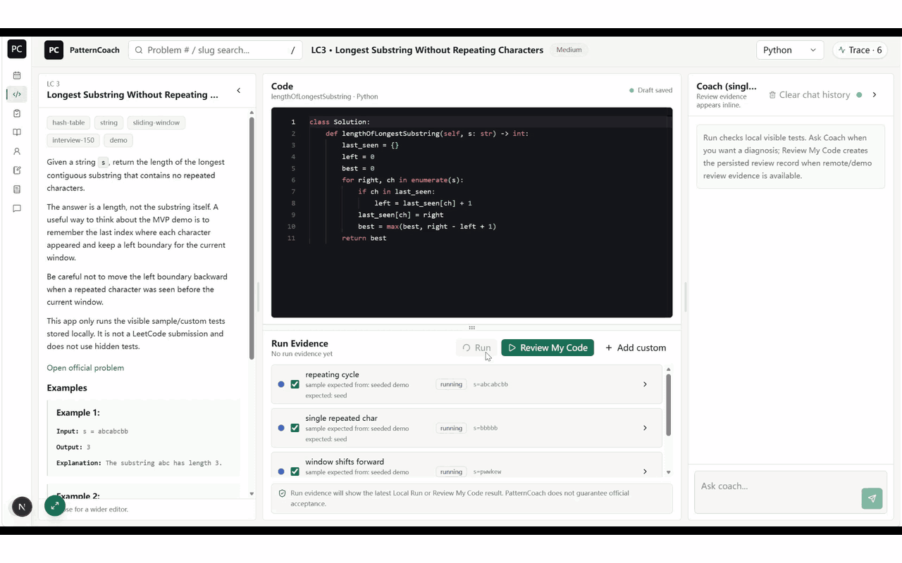
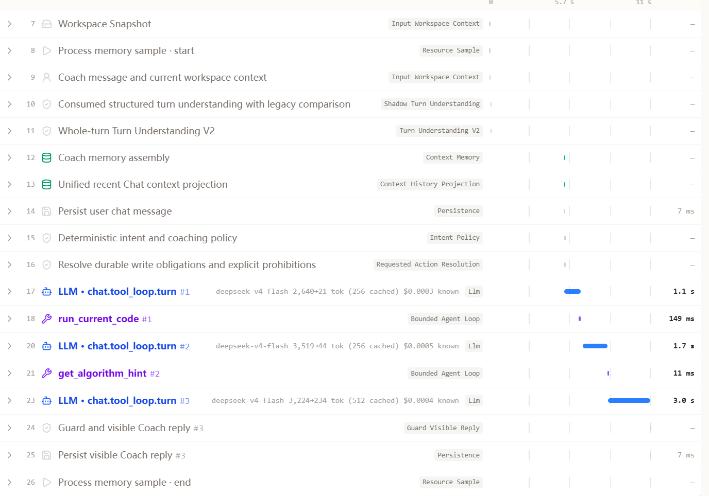
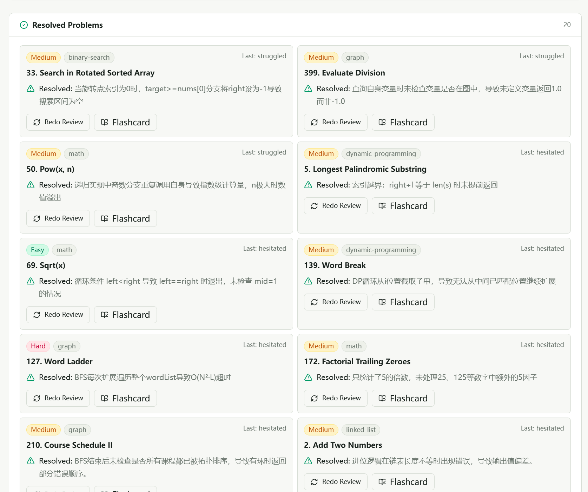
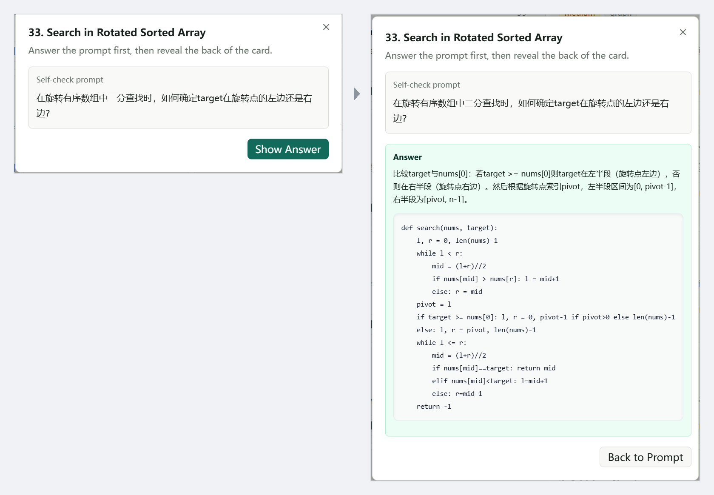
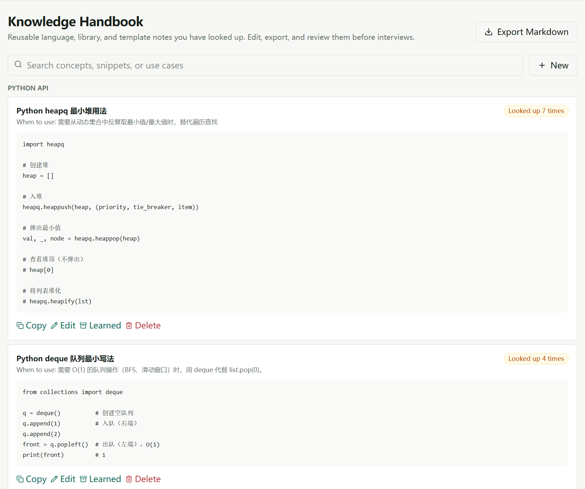
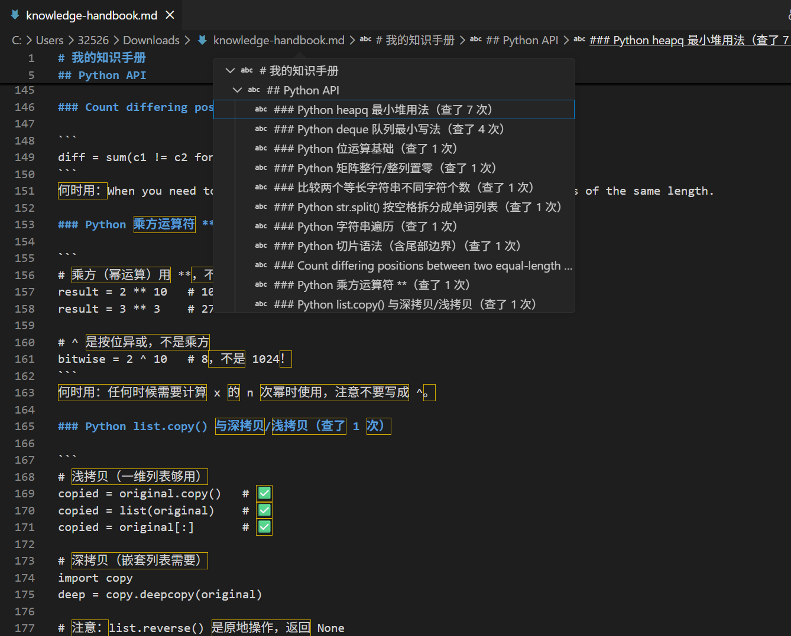
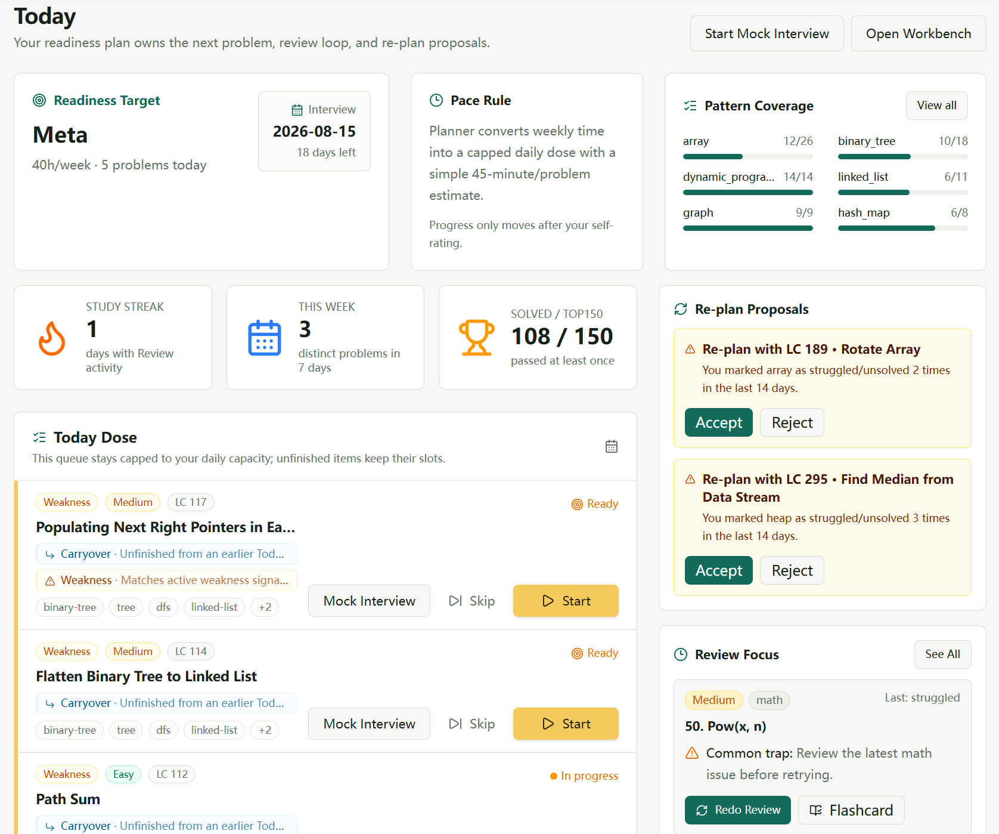
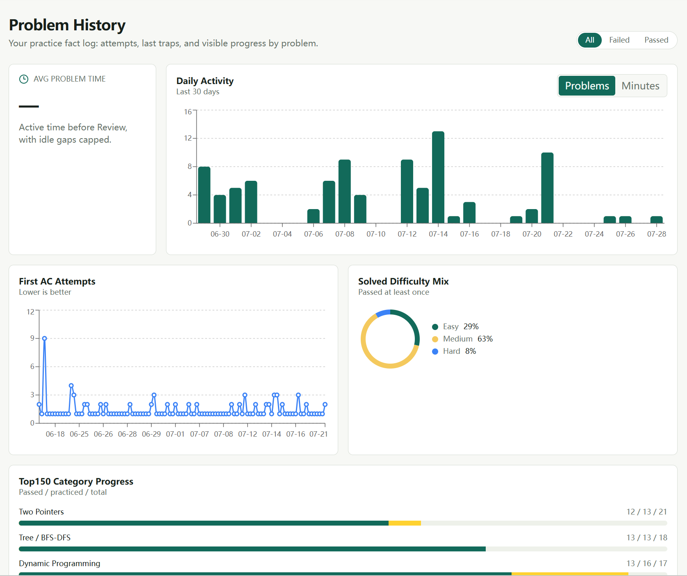
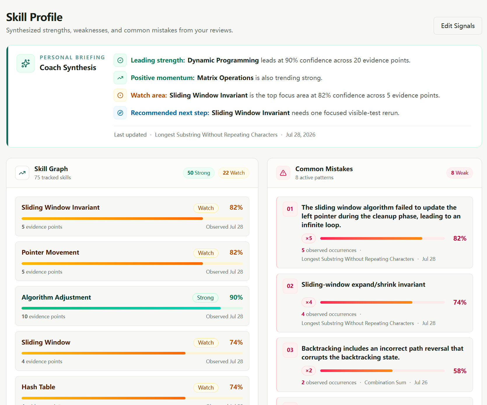

<h1 align="center">PatternCoach AI</h1>

<p align="center"><b><i>Your coding history should coach you back.</i></b></p>

<p align="center">
  A local practice workbench for the Interview-150 list.<br>
  It runs your Python, reads the actual failure, and remembers what tripped you up.
</p>

<p align="center">
  
  
  
  
  
</p>

<p align="center">
  
</p>

<p align="center">
  <a href="#-get-it-running">Get it running</a> ·
  <a href="#-questions-you-probably-have">FAQ</a> ·
  <a href="#-where-your-stuff-lives">Your data</a> ·
  <a href="docs/user-guide.md">User guide</a>
</p>

---

## What this is

You solve a problem, get it wrong, read someone's explanation, and move on. Two weeks later you make the same mistake on a different problem and do not notice.

PatternCoach turns that loop into a local practice system that gets more useful as you use it:

- 🧠 **Learning event → stable fact → cross-problem profile.** Runs, Reviews, and chats leave an inspectable trail; repeated evidence becomes skill or mistake facts, then a living Profile that helps the Coach meet you where you are.
- ⚡ **Evidence before advice.** Piston runs your Python against the public visible tests you select **and the custom cases you add**, captures outputs and the first failure, then grounds Review in what actually happened.
- 💬 **Hints that keep you thinking.** Ask for a small next step, trace a failure, or unlock progressive hints from level 1 to 3—without being buried under an instant full solution.
- 📚 **More than a chat transcript.** Turn a recurring bug into a Mistake Book repair guide and flashcard; save reusable Python, API, and pattern notes to your Knowledge Handbook and export them as Markdown.
- 🎯 **Every next problem has a reason.** A goal-based Today plan, self-rating-driven review intervals, and Review Focus bring due work and recurring weak patterns back at the right time.
- 🔒 **Local-first, inspectable, and yours.** Your drafts, runs, history, plan, and learning artifacts stay in local SQLite; an external Coach is optional, never required.

---

## What using it looks like

### The loop



**Nothing the coach does is a black box.**
*Every model call, every tool it ran, what each one cost, how long each took. One turn, on the record.*

<br>

### What it keeps



**Your mistakes file themselves.**
*Each entry keeps the actual root cause — not "got it wrong", but which branch, which boundary, which line.*

<br>



**Then you can drill them.**
*Answer from memory first, then reveal. The prompt comes from your own failure, so it asks the thing you actually missed.*

<br>



**Notes that earn their place.**
*"Looked up 7 times" isn't a label you typed. It's how often you actually needed it.*

<br>



**And they leave with you.**
*One click, one Markdown file, headings and code fences intact. No export tier, no lock-in.*

<br>

### Where you are



**A plan you didn't have to build.**
*Target date in, daily dose out. When it notices you've stalled on a pattern it proposes a re-plan — and waits for you to accept it.*

<br>



**Progress you can't fake.**
*First-AC attempts, and passed / practiced / total per category. These move when you solve something, not when you open the app.*

<br>



**It keeps score, and it shows its work.**
*Every line carries a confidence and the number of attempts behind it. Nothing here declares you bad at something — a skill sits at **Watch** until enough evidence agrees, and each mistake pattern names the problem it came from.*

---

## ⚡ Get it running

You need **Node** (`^20.19`, `^22.12`, or `>=24`), **npm**, and **Docker** — Docker is what actually executes your Python, in a container, on your machine.

```bash
git clone https://github.com/Iriss0904/personalized-leetcode-coach.git
cd personalized-leetcode-coach/web

npm ci
npm run setup        # local env + database
npm run piston:up    # start the Python sandbox
npm run piston:smoke # prove it can really run code
npm run doctor       # check everything before you start
npm run dev
```

Open **<http://localhost:3000>**. That's it — no API key needed to start.

<details>
<summary>If the smoke test says Python 3.12.0 is missing</summary>

<br>

The sandbox downloads its runtime once, and only when you approve it:

```bash
npm run piston:install -- --confirm
npm run piston:smoke
npm run doctor
```

</details>

Full setup, provider configuration, and shutdown: **[setup guide](docs/user-setup.md)** · Something broken: **[troubleshooting](docs/troubleshooting.md)**

---

## 🤔 Questions you probably have

<details>
<summary><b>Do I need an API key?</b></summary>

<br>

No. There's a built-in coach that works offline — it reads your run evidence and gives you deterministic, rule-based feedback. It's genuinely useful and it never makes anything up.

If you point the app at any OpenAI-compatible provider (three env vars: `LLM_BASE_URL`, `LLM_API_KEY`, `LLM_MODEL`), the coach gets conversational and can use its tools. That's your key, your provider, your bill — the project ships with no default.

</details>

<details>
<summary><b>What does it cost to run?</b></summary>

<br>

The app is free and there is nothing to subscribe to. If you bring your own provider, you pay that provider directly — and you can see exactly what for.

Every model call is recorded with its token counts, cached-token count, latency, and cost, which is what the trace above is showing. A coaching turn that ran two tools and three model calls came to about a tenth of a cent on a small model. Your mileage depends entirely on which model you point it at.

</details>

<details>
<summary><b>Why is this slower than just pasting my code into a chatbot?</b></summary>

<br>

Because it actually runs your code first.

Every review sends your selected tests into the sandbox, waits for the real result — first failing case, your stdout, the runtime error if there was one — and only then writes the diagnosis, in a single model call, from that evidence.

The two or three seconds you're waiting is the container, not the model. It buys you feedback that can't be about a bug you don't have.

There is no simulated run path in this project. If the sandbox is down, you get an error, not an answer.

</details>

<details>
<summary><b>Why won't it just fix my code?</b></summary>

<br>

Because a fix that replaces your approach teaches you nothing, and because you'd have read it in three seconds and learned it for none.

Ask for one hint and you get one hint. Ask it to walk the first failing case and it walks the case with you. When it does suggest a change, it's the smallest one that keeps your idea alive — not a rewrite into the canonical solution.

Optimization is opt-in, and only after the thing works. It won't lecture you about time complexity while your code is still broken.

</details>

<details>
<summary><b>Can I add problems that aren't in the 150?</b></summary>

<br>

Yes, and it's not a special case — a problem here is a contract, not a hardcoded test file: a method signature, a typed I/O schema, a serialization adapter, and a comparison strategy. All 150 in the repo use that same shape, so the fastest route is to copy the closest one.

They live in [`web/src/data/hot150/`](web/src/data/hot150/). PRs welcome.

</details>

<details>
<summary><b>Does my code leave my machine?</b></summary>

<br>

Not unless you configure an external provider.

Out of the box: your drafts, runs, chats, plans, history, mistakes, and notes are written to a SQLite file on your disk, and your Python is executed by a container on `127.0.0.1`. Nothing is sent anywhere.

If you do configure a provider, the app sends that provider the current request, your draft, the problem, a small focused slice of your learning records, and the results of any tool the coach ran — not your full local history. The exact boundary is written down in the **[privacy guide](docs/privacy.md)**, and it's worth two minutes before you paste in a key.

</details>

<details>
<summary><b>Can the coach change my profile behind my back?</b></summary>

<br>

No. Saving a preference, a handbook note, or a mistake entry is something you ask for out loud.

The coach has tools that write, but they're gated: durable writes require an explicit request from you, enforced in code rather than requested in a prompt. It can't quietly decide what your weaknesses are, and it can't rewrite your plan because a conversation drifted.

</details>

<details>
<summary><b>What exactly runs where?</b></summary>

<br>

Fair question to ask before installing something. The whole data path — UI, the coach, the sandbox, the database, what touches the network and what never does — is written up in the **[architecture overview](docs/architecture-overview.md)**. It's short.

</details>

---

## 🔒 Where your stuff lives

One SQLite file: `web/data/patterncoach.db`.

Everything is in there — drafts, runs, the evidence from each run, diagnoses, chats, review episodes, what it has learned about you, your plan, your mistakes, your notes. Twenty-three tables, no cloud copy, no telemetry.

Delete the file and you are a new user. That's the entire uninstall procedure for your data.

---

## 🚧 What it won't do

Deliberate, not missing:

- **No verdicts.** It runs visible tests, never LeetCode's hidden ones, and never claims Accepted.
- **No bundled problem statements.** Titles and links only — the text belongs to LeetCode, so the app links you out. What ships here is the runnable Python contract for each problem.
- **Python only.** One language, done properly.
- **No offline mode for code execution.** Docker has to be up. Real execution or nothing.
- **It won't quietly rewrite your plan.** Self-rating a review updates your schedule; a freeform chat doesn't.
- **It's v0.1.** The local coach is rule-based; the interesting conversational behavior needs your own provider.

<details>
<summary>The full, boring version of the limitations</summary>

<br>

- The catalog contains 150/150 local Python contracts with independently authored visible-test sets. These are not official or hidden judge tests.
- Docker and a healthy sandbox are required for **Run Code** and **Review My Code**.
- Today schedules from your goal and available study time. Review self-ratings complete matching items, update review schedules, and feed Review Focus; open-ended chat requests do not automatically rewrite the plan.
- Skill Profile preferences are editable, and real reviews update skill and mistake facts plus local synthesis. Public v0.1 does not use embedding or vector retrieval — recall is SQLite FTS5, focused facts, recent episodes, and recent chat turns. There is no background consolidation service.
- Coach Chat dispatches a fixed set of eight tools with a hard step cap. Durable Profile, Memory, Handbook, and Mistake Book writes require an explicit user request or confirmation.
- The built-in local coach is deterministic; model-powered responses require your own compatible provider.

</details>

---

## Docs

| Doc | What's in it |
|---|---|
| [Setup guide](docs/user-setup.md) | Install, sandbox, providers, shutdown |
| [User guide](docs/user-guide.md) | How to actually get value out of the coach |
| [Troubleshooting](docs/troubleshooting.md) | When Docker or the runtime misbehaves |
| [Data and privacy](docs/privacy.md) | What is stored, what is sent, and when |
| [Architecture overview](docs/architecture-overview.md) | The whole data path, briefly |

---

<sub>

Licensed under **[AGPL-3.0-only](LICENSE)**. Third-party and content notices in **[NOTICE](NOTICE)**.
Code execution uses **[Engineer Man Piston](https://github.com/engineer-man/piston)**, an independent project.
LeetCode and its problem titles are third-party content and trademarks. This project is not affiliated with or endorsed by LeetCode.

</sub>
